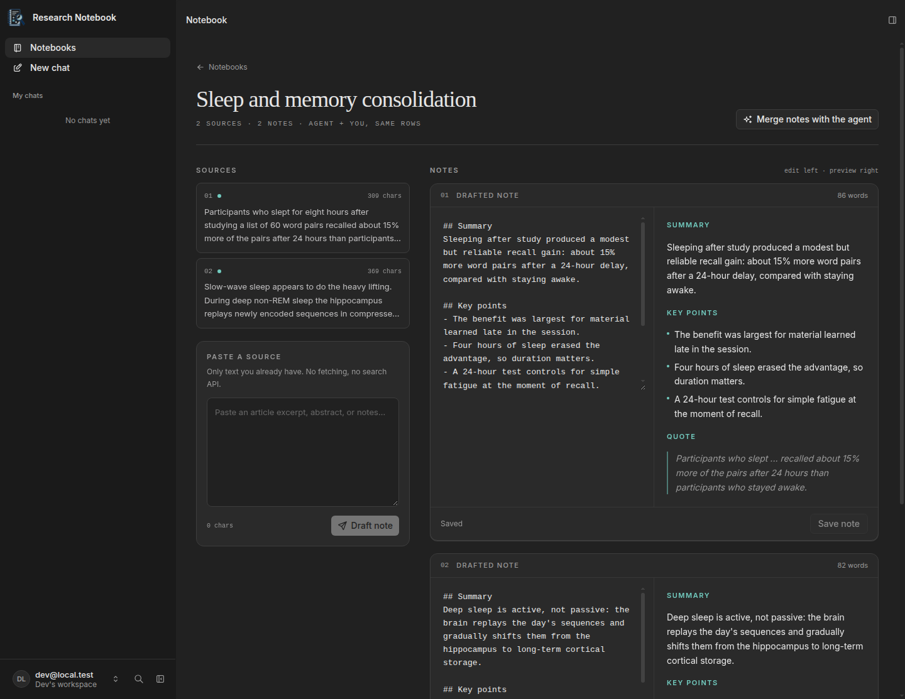
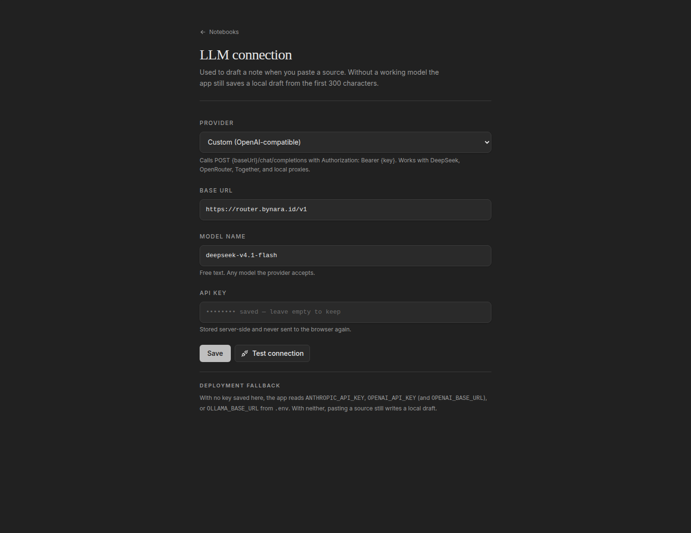

# ResearchNotebook

Paste what you are reading. Get a structured note you can edit. Ask the agent to
refine it. Both of you write through the same action, onto the same row.

Built for the **Agent-Native Hackathon by Builder.io** (November 2026).

## The problem

Research happens in three disconnected tabs. You find a source in one, take notes
in another, and ask an AI in a third. Nothing is connected, so every step is a
copy-paste, and the assistant never sees the note you just edited.

## The idea

One small notebook where the agent and the person share the same notes.

- You create a notebook for a topic and paste source text into it. There is no
  crawler and no search API, so the demo works offline and never depends on a
  site staying up.
- The agent turns each source into a structured draft: a summary, key points,
  and one verbatim quote.
- You edit that draft inline and save it. The agent can then expand it, rewrite
  a point, or merge several notes, using the same action the Save button uses.

The point is not that an AI can write a note. The point is that the interface
and the agent are two callers of one data layer, so an edit made in either place
is immediately real in the other.



## The shared-action proof

Every capability is a single `defineAction()` in `actions/`. The framework
exposes the same definition as a React hook, an agent tool, an HTTP endpoint, an
MCP tool, and a CLI command.

`update-note` is the clearest example:

1. The editor's **Save note** button calls `useActionMutation("update-note")`.
2. The agent calls the `update-note` tool with the same `noteId`.
3. Both land in the same PostgreSQL row through the same Zod-validated handler.

There is no second write path and no sync step. The editor footer says so while
you use it: "Saved, the agent reads this same row."

## What is in the app

- Notebook list with one-field topic creation and source/note counts.
- Notebook workspace: pasted sources on the left, drafts on the right.
- Markdown editor with a live preview that understands the note shape
  (`## Summary`, `## Key points`, `## Quote`).
- A connection panel for five model providers, including a tested
  OpenAI-compatible custom endpoint.
- Two seeded notebooks with real source text and drafts, so the app is useful on
  first boot with no network and no API key.



## The model connection

`/settings` supports Builder.io, OpenAI, Anthropic, Ollama (local), and Custom
(OpenAI-compatible).

- Custom providers are called as `POST {baseUrl}/chat/completions` with
  `Authorization: Bearer {key}` and `{ model, messages }`. That covers DeepSeek,
  OpenRouter, Together, a corporate gateway, or a local proxy.
- **Test connection** sends one minimal request and prints the provider's reply
  or its error inline, before anything is saved.
- Keys are stored server-side with the settings row and are never returned to
  the browser or written into the client bundle.
- With no connection configured, the app reads `ANTHROPIC_API_KEY`,
  `OPENAI_API_KEY` (plus `OPENAI_BASE_URL`), or `OLLAMA_BASE_URL` from the
  deployment environment.
- With neither, `add-source` still saves a local draft built from the first 300
  characters of the source and labels it "local draft". Drafting never crashes
  the paste.

The in-app agent chat has its own workspace connection under `/settings/agent`.

## Under the hood

| Layer | Choice |
| --- | --- |
| Framework | Agent-Native (`@agent-native/core`, `@agent-native/toolkit`) |
| UI | React 19, React Router 8, Tailwind CSS 4 |
| Data | PostgreSQL via Drizzle ORM; local PGlite in development |
| Agent | Agent chat with a tool list limited to the notebook actions |
| Fonts | Inter, bundled locally (no Google Fonts request) |

Data model:

```text
notebooks (id, topic, created_at)
sources   (id, notebook_id, raw_text, created_at)
notes     (id, notebook_id, source_id, draft_kind, content, created_at, updated_at)
```

Actions:

| Action | Contract |
| --- | --- |
| `list-notebooks` | notebooks with source and note counts |
| `get-notebook` | one notebook with its sources and notes |
| `create-notebook` | `{ topic } -> { notebookId }` |
| `add-source` | `{ notebookId, text } -> { sourceId, noteId, draft, mode }` |
| `update-note` | `{ noteId, content } -> { noteId, content }` |

`add-source` is the only place that talks to a model: it drafts the note, then
stores the source and the note in one transaction. The agent's system prompt
allows writes only through these actions, and `update-note` is the only way any
caller can change a note.

## Run it

Requirements: Node 22.22 or newer, and pnpm.

```bash
git clone https://github.com/Nassami1/research-notebook.git
cd research-notebook
pnpm install
pnpm dev
```

Open <http://localhost:8080>. The first boot creates the schema and seeds two
notebooks.

The local demo sets `AUTH_DISABLED=true` in `.env` so it opens without an
account. Remove that line to run with the template's normal sign-in.

## The 90-second demo

1. Open a seeded notebook, for example "Sleep and memory consolidation".
2. Paste a paragraph into the source box and press **Draft note**. The model
   returns Summary, Key points, and Quote.
3. Change one line in the editor. The preview updates as you type.
4. Press **Save note**. The note is written through `update-note`.
5. Open the agent rail and ask it to expand the newest bullet with one more
   detail from its source. The same card updates without a refresh.
6. Open `/settings`, show the providers, and press **Test connection** against a
   custom endpoint.

## Project layout

```text
actions/                 one defineAction per file
server/db/schema.ts      notebooks, sources, notes
server/db/index.ts       Drizzle client
server/plugins/db.ts     additive migration and seed data
server/lib/llm.ts        saved provider -> engine descriptor
server/plugins/agent-chat.ts  agent tools and system prompt
app/routes/_index.tsx    notebook list
app/routes/n.$id.tsx     notebook workspace
app/routes/settings.tsx  model connection
app/components/notes/    editor and markdown preview
public/logo.svg          source lockup; logo-icon.png in the app chrome
```

## Status and limits

This is a local-first hackathon build.

- The demo database is PGlite on disk. A public deploy needs a persistent
  `DATABASE_URL` and a `BETTER_AUTH_SECRET`, and must leave `AUTH_DISABLED`
  unset. `pnpm build` refuses to build until those are provided.
- Notebooks are single-user; there is no sharing or tenancy yet.
- Deleting a note is not exposed; the submitted workflow is paste, draft, edit,
  refine.
- Web crawling, PDF export, and confidence scoring are deliberately out of
  scope.

## Acknowledgements

Built with [Agent-Native](https://www.agent-native.com) and submitted to the
[Agent-Native Hackathon](https://www.builder.io/hackathon) by Builder.io. The
logo was provided with the project brief.
